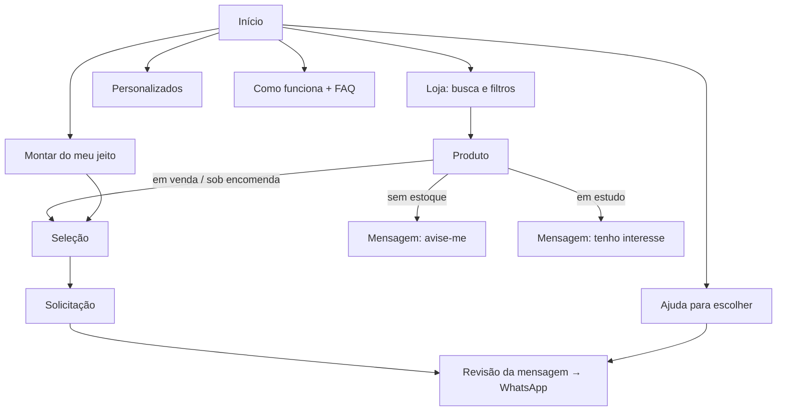

# Love in Box: plano do website (MVP, versão 1)

Data: 26/10/2026 · Fonte de requisitos: *Briefing de desenvolvimento* v1.0 (MD e PDF).

---

## 1. Interpretação do MVP e limites de escopo

**O MVP é** uma loja-vitrine mobile-first que parece completa para o cliente e é simples de operar:
catálogo navegável → página do produto → solicitação estruturada → WhatsApp.
O cliente vê sempre que **solicitação não é compra concluída**.

**Três portas de entrada, todas com destino real:**

| Porta | Destino no MVP |
|---|---|
| Quero um presente pronto | Loja com filtros → produto → seleção → solicitação |
| Quero montar do meu jeito | Página de seleção de base + complementos → solicitação. Não há prévia da caixa nem regras de compatibilidade (Fase 3). |
| Preciso de ajuda para escolher | Questionário curto → mensagem de WhatsApp. Lista itens do catálogo dentro do orçamento marcado (filtro simples, não recomendação). |

**Fora do MVP:** checkout, pagamento, frete automático, envio nacional, montador com prévia, IA.

**Regras de conteúdo aplicadas:**
- Preços do controle de 26/10/2026 marcados como provisórios (`precoProvisorio: true`).
- Status explícitos: em venda, sob encomenda, sem estoque, em estudo. **Em desenvolvimento** fica cadastrado e oculto
  (Love Scoop Mini, Café e Premium; Box Criar; Box Lanchinho & Diversão; Box Meu Dia Especial; Livrinho 12 Detalhes).
- Nenhuma foto, descrição técnica, prazo ou política foi inventada. Faltando foto, o card mostra "foto em breve".
- Logo original (`Logo_-_LOVEINBOX.png`) e ícones oficiais usados como arquivos, apenas redimensionados.

---

## 2. Mapa do site e fluxos

**Navegação principal:** Loja · Categorias (menu com categorias, subcategorias, ocasiões e orçamento) · Boxes e kits ·
Personalizados · Ajuda para escolher. No celular, menu lateral com as mesmas entradas e acesso a "Montar do meu jeito".

**Categorias (tipo de produto):** Canecas · Fotos e lembranças · Boxes e kits · Complementos (Café e chá, Papelaria).
**Coleções (tema/ocasião):** Para quem ama café · Chá e aconchego · Lembranças com foto · Aniversário.
As coleções são **proposta** para aprovação.

**Homepage:** hero com vídeo real → três portas → categorias → vitrine (destaques) → personalização (foto → caneca)
→ ocasiões e orçamento → boxes → como funciona → fotos reais → FAQ → chamada final → rodapé.

---

## 3. Stack e modelo de catálogo

**Stack proposta: site estático (HTML + CSS + JS, sem framework).**
- Custo zero de hospedagem (Vercel, Netlify ou GitHub Pages), nada para atualizar ou quebrar.
- Leve no celular: ~70 KB de JS próprio (cerca de 20 KB com a compressão da hospedagem), imagens otimizadas, vídeo com pausa e versão menor no mobile.
- GitHub + Vercel funcionam bem aqui, mas não são obrigatórios.

**CMS:**
- **Agora:** edição direta de `assets/js/catalogo.js` (dá para editar pelo próprio site do GitHub).
- **Quando o catálogo passar de ~30 itens ou outra pessoa for editar com frequência:** Decap CMS (gratuito,
  painel visual que grava no mesmo repositório) ou uma planilha publicada como fonte. O layout não muda, porque
  já lê tudo do arquivo de dados.

**Modelo de dados (`catalogo.js`):**

| Entidade | Campos |
|---|---|
| status | rótulo, ação do botão (seleção, aviso, interesse), visível |
| categoria | id, nome, ícone, resumo, subcategorias[] |
| coleção | id, nome, tipo (tema, ocasião, campanha), ícone, resumo, produtos[] |
| produto | id, nome, categoria, subcategoria, status, preço, tipo de preço, preço provisório, resumo, personalização[], variantes[], imagens[{src, alt}], destaque, ordem |

---

## 4. Estrutura de pastas e componentes

Ver `LEIA-ME.md` (seção 3). Componentes reutilizáveis em `styles.css`: bloco (`.tile`), botões, selos de status,
chips, card de produto, placeholder de foto, trilho com rolagem lateral, bloco dividido, passos, FAQ, formulário,
gaveta, folha inferior e modal. Referência visual em `design-system.html`.

**Wireframes:** o protótipo navegável já está em alta fidelidade em celular (a partir de 320 px) e desktop.
Se a designer precisar de wireframes de baixa fidelidade para apresentação, eles podem ser derivados das telas atuais.

---

## 5. Decisões bloqueantes (antes de publicar)

1. **WhatsApp oficial.** Sem o número, os botões mostram a mensagem para copiar.
2. **Preços e disponibilidade** validados na planilha editável.
3. **Fotos reais** dos produtos. Hoje só a caneca branca tem fotos; a box também precisa de foto.
4. **Tipografia.** Mantidas Baloo 2 (títulos) + Nunito (texto) do site anterior. Alternativas para comparar:
   Fraunces + Nunito (mais editorial) ou Baloo 2 + DM Sans (mais neutra).
5. **Campos de personalização** por produto (hoje genéricos: foto, nome, frase, arte pronta).
6. **Políticas** de prazo, retirada (local e horário) e entrega local.
7. **Instagram oficial e domínio.**
8. **Coleções por ocasião** (proposta).
9. Revisão jurídica do texto de privacidade.

---

## 6. Roadmap

**Fase 1 (MVP, esta entrega):** design system, homepage, categorias, subcategorias e coleções, catálogo editável,
páginas de produto com status, busca e filtros, seleção, solicitação e ajuda via WhatsApp, FAQ, SEO básico,
acessibilidade (axe sem violações nas páginas principais) e responsividade de 320 px a desktop.

**Fase 2 (curadoria):** descoberta por destinatário, ocasião e orçamento com recomendações; coleções sazonais;
busca melhor; CMS visual (Decap) se o volume pedir; páginas de produto geradas estaticamente para SEO.

**Fase 3 (montador):** escolha de embalagem, itens e complementos com prévia; regras de compatibilidade; estoque;
eventual checkout e frete **após validação operacional e financeira**.

**IA para personalização:** só depois de definir custo por geração, limites, revisão humana, privacidade e
fidelidade dos mockups. Não entra no MVP.

---

## 7. O que é funcional e o que é previsto

| Item | Situação |
|---|---|
| Navegação, loja, filtros, busca, produto | Funcional |
| Seleção de itens (salva no aparelho) | Funcional |
| Solicitação e ajuda → mensagem de WhatsApp | Funcional; abre o WhatsApp quando o número for configurado |
| Status de disponibilidade | Funcional, controlado pelo catálogo |
| Montador com prévia da caixa | Previsto (Fase 3) |
| Recomendação de presentes | Previsto (Fase 2); hoje há só filtro por orçamento/gosto |
| Pagamento, frete, envio nacional, IA | Fora do escopo atual |
